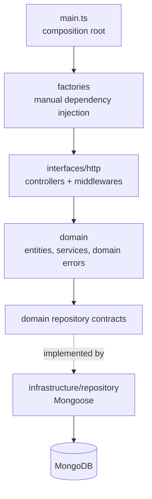

# Movie Track

A REST API to log the movies you have watched: rate them, write a review, mark
favorites and find them again with search, filters and sorting.

Built with Node.js + TypeScript following Clean Architecture, with a
contract-first OpenAPI spec that validates every request **and** response at
runtime.

## Features

- **Accounts and auth** — sign up, log in and refresh tokens (JWT access +
  refresh tokens, bcrypt password hashing). Every movie route is scoped to the
  authenticated user.
- **Movie log** — log a watched movie with rating (1–10, half steps), review,
  genres, release year, director, duration, poster and watch date.
- **Posters** — upload a JPEG, PNG or WebP poster (up to 5 MB) stored in
  Cloudinary, or point to an external poster URL.
- **Search and filters** — search by title (case- and accent-insensitive),
  filter by genre, rating range and favorites, sort by watch date, rating,
  title or release year, with pagination.
- **Favorites** — mark or unmark any logged movie.
- **Stats** — totals, average rating, rating distribution, movies per month
  and top genres of my own movie log.
- **Watchlist** — save movies to watch later, search them, and move one to the
  movie log once watched (`watchlistItemId` in `POST /movies`).
- **Genres** — a fixed list of genres, seeded on startup and mapped to TMDB
  genre IDs.
- **Movie search** — search TMDB by title to prefill a movie or a watchlist
  item (title, year, synopsis, poster and genres already mapped to ours).

## Tech stack

| Area | Tools |
| --- | --- |
| Runtime | Node.js 20, TypeScript (strict) |
| HTTP | Express, Helmet, express-openapi-validator |
| Data | MongoDB, Mongoose |
| Auth | jsonwebtoken, bcryptjs |
| File storage | Cloudinary |
| Movie data | TMDB API |
| Observability | OpenTelemetry (traces), structured JSON logs with `trace_id` |
| Quality | Jest (unit + integration with mongodb-memory-server), ESLint, Prettier |
| API docs | Swagger UI (`/docs`) |
| Delivery | GitHub Actions CI (lint, build, tests with an 80% coverage gate), Docker and docker compose, Conventional Commits + semantic-release |

## Architecture



- **`src/domain`** — entities, services and repository contracts. Pure business
  logic: it imports nothing from the other layers.
- **`src/interfaces/http`** — thin controllers, authentication and a central
  error handler that maps domain errors to HTTP responses.
- **`src/infrastructure`** — Mongoose repositories, providers (JWT, bcrypt,
  clock, Cloudinary storage, TMDB catalog), env validation, factories and telemetry.
- **`src/contracts/service.yaml`** — the OpenAPI spec, the source of truth for
  the API.

More in [docs/architecture.md](docs/architecture.md).

## API

All `/movies`, `/watchlist` and `/tmdb` routes require `Authorization: Bearer <access token>`.

| Method | Route | Description |
| --- | --- | --- |
| `POST` | `/users` | Create an account |
| `GET` | `/users` | List users |
| `GET` / `PUT` / `DELETE` | `/users/{id}` | Get, update or delete a user |
| `PATCH` | `/users/{id}/password` | Change the password |
| `GET` | `/users/{id}/stats` | My movie stats (totals, ratings, months, top genres) |
| `POST` | `/auth/login` | Log in with email and password |
| `POST` | `/auth/refresh` | Refresh the tokens |
| `POST` | `/movies` | Log a watched movie |
| `GET` | `/movies` | List my movies (search, filters, sorting, pagination) |
| `GET` / `PUT` / `DELETE` | `/movies/{id}` | Get, update or delete one of my movies |
| `PATCH` | `/movies/{id}/favorite` | Mark or unmark a movie as favorite |
| `PUT` | `/movies/{id}/poster` | Upload a movie's poster (`multipart/form-data`, field `poster`) |
| `DELETE` | `/movies/{id}/poster` | Remove a movie's poster |
| `POST` | `/watchlist` | Add a movie to my watchlist |
| `GET` | `/watchlist` | List my watchlist (search, pagination) |
| `DELETE` | `/watchlist/{id}` | Remove a movie from my watchlist |
| `GET` | `/tmdb/search` | Search movies in TMDB to prefill a movie or watchlist item |
| `GET` | `/genres` | List the genres |
| `GET` | `/health` | Health check |
| `GET` | `/docs` | Swagger UI |

The full request and response shapes are in
[src/contracts/service.yaml](src/contracts/service.yaml).

## Running locally

Requirements: Node.js 20+, Yarn, a MongoDB instance, a Cloudinary account and a TMDB API token.

```bash
yarn install
cp .env.example .env
```

Edit `.env`: set `DATABASE_URI` and generate two **different** secrets for
`JWT_SECRET` and `REFRESH_TOKEN_SECRET`:

```bash
node -e "console.log(require('crypto').randomBytes(64).toString('hex'))"
```

For poster uploads, copy the cloud name, API key and API secret from
**Settings > API Keys** in the Cloudinary console into `CLOUDINARY_CLOUD_NAME`,
`CLOUDINARY_API_KEY` and `CLOUDINARY_API_SECRET`. For movie search, copy the
**API Read Access Token** from **Settings > API** on themoviedb.org into
`TMDB_ACCESS_TOKEN`. The app does not boot without them.

Then:

```bash
yarn dev                   # development mode
yarn build && yarn start   # compiled build
```

### With Docker

`docker compose up --build` starts the API and its own MongoDB in one command.
It reads the secrets from `.env` but ignores its `DATABASE_URI`: the API always
uses the MongoDB container, whose data lives in the `mongo-data` volume
(`docker compose down -v` wipes it). Set `API_PORT` to publish the API on a
port other than 3000.

### API docs

With the app running, open [http://localhost:3000/docs](http://localhost:3000/docs)
for Swagger UI, generated from the same contract that validates the requests.
Log in with `POST /auth/login`, click **Authorize** and paste the `accessToken`
to call the protected routes.

## Tests and quality

```bash
yarn test           # unit + integration (no local MongoDB needed)
yarn test:coverage  # with the merged 80% lines/branches gate used in CI
yarn lint
```

Integration tests run against an in-memory MongoDB (`mongodb-memory-server`).

## Design decisions

- **Contract-first:** the OpenAPI spec validates requests and responses, so the
  documentation cannot drift from the implementation.
- **Domain errors, not HTTP codes, in services:** services throw typed errors
  (`NotFoundError`, `ConflictError`, `UnprocessableEntityError`…) and a single
  middleware turns them into HTTP responses.
- **Manual dependency injection:** static factories wire everything in one
  place, which keeps services easy to test with fakes.
- **Read/write repository split:** each feature has separate read and write
  contracts.
- **Traceable logs:** every log line inside a request carries the active
  `trace_id`, so logs and traces can be correlated
  ([docs/observability.md](docs/observability.md)).

## Roadmap

- [ ] A public deploy

## Documentation

- [docs/architecture.md](docs/architecture.md) — layers, request flow and dependency injection
- [docs/conventions.md](docs/conventions.md) — naming and code patterns
- [docs/testing.md](docs/testing.md) — testing strategy
- [docs/observability.md](docs/observability.md) — OpenTelemetry and logging

## Credits

The project structure started from
[whitebeardit/node-boilerplate](https://github.com/whitebeardit/node-boilerplate).
