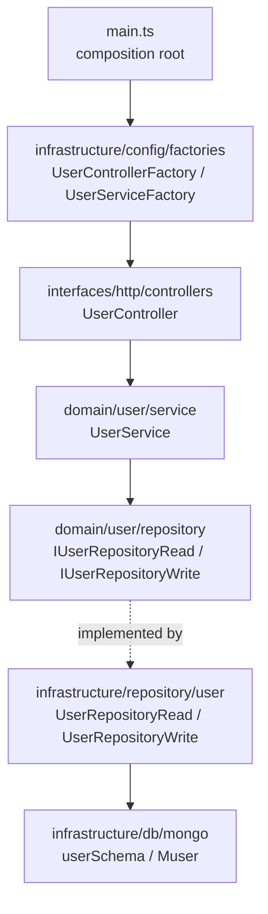

# Architecture

## Overview

Clean Architecture with vertical slices per feature. The `user` slice is the
canonical example — every new feature must mirror it file by file.



**Dependency rule:** `domain/` is pure — it does not import `infrastructure/`
or `interfaces/`. Repository contracts live in the domain
(`src/domain/user/repository/user.repository.read.ts` → `IUserRepositoryRead`);
implementations live in infrastructure
(`src/infrastructure/repository/user/user.repository.read.ts` → `UserRepositoryRead`).
The **file names are identical** on both sides — the directory distinguishes
contract from implementation. Do not mix them up when editing.

## Read/write split (light CQRS)

Each feature has two repository contracts:

- `I<Feature>RepositoryRead` — `findUserById`, `findUserByEmail`, `searchUsers`, `countUsers`
- `I<Feature>RepositoryWrite` — `createUser`, `updateUserById`, `deleteUserById`

The service receives both via a parameter object:

```ts
export class UserService implements IUserService {
  private userRepositoryRead: IUserRepositoryRead;
  private userRepositoryWrite: IUserRepositoryWrite;

  constructor({ userRepositoryRead, userRepositoryWrite }: IParamsUserService) {
    this.userRepositoryRead = userRepositoryRead;
    this.userRepositoryWrite = userRepositoryWrite;
  }
}
```

## Dependency injection

Manual DI, no container. Static factories in
`src/infrastructure/config/factories/`, one per artifact, with a `static create()`:

```ts
// user.service.factory.ts
export class UserServiceFactory {
  static create() {
    return new UserService({
      userRepositoryRead: new UserRepositoryRead(),
      userRepositoryWrite: new UserRepositoryWrite(),
    });
  }
}

// user.controller.factory.ts
export class UserControllerFactory {
  static create(): IController {
    return new UserController(UserServiceFactory.create());
  }
}
```

Rules:

1. All composition happens in factories — never inside services/controllers.
2. Factories do **no I/O at module load**; side effects only inside `create()`.
3. `main.ts` only knows controller factories.

## Server lifecycle (`src/interfaces/http/server.ts`)

Initialization order in the `Server` constructor:

1. `/health` route (registered **before** the middlewares — which is why it escapes the OpenApiValidator).
2. Middlewares: `express.json({ limit: '3mb' })` → `express.urlencoded` →
   `ContextAsyncHooks.getExpressMiddlewareTracking()` (traceability cid) → `helmet()` →
   extra middlewares passed via `middlewaresToStart` in the constructor.
3. `OpenApiValidator.middleware` with `validateApiSpec: true` and `validateResponses: true`.
4. Controller routes (`controller.getRoutes()` mounted at `/`).
5. **Central error handler** (`errorHandlerMiddleware` in `src/interfaces/http/middlewares/error-handler.middleware.ts`,
   mounted by `errorHandler()`): the only place that translates
   errors into HTTP responses. `toErrorResponse` (`error-response.mapper.ts`)
   classifies the error into `{ message, status, code, errors? }`: `DomainError`,
   validator `HttpError` (400 with `errors: [{ field, message }]`, 401, 404, 405, 415),
   body-parser errors (400 `INVALID_JSON`, 413), Mongo errors (409 duplicate key,
   400 cast/validation, 503 database unavailable) and, only for anything else,
   500 `INTERNAL_ERROR`. The middleware logs 5xx (with method, path and stack) and
   answers; the full table is in [conventions.md](conventions.md#http-responses-the-user-slice-pattern).

Service methods are decorated with `@ErrorHandler()`
(`src/domain/common/decorators/error-handler.decorator.ts`): domain errors pass
through untouched; anything else is logged with the service and method names
(`eventName: 'service.unexpected_error'`) and rethrown to the central handler.

In `main.ts`, the boot order is: telemetry (first-line import) → env validation
(`infrastructure/config/env.ts`, fail-fast) → `new Server(...)` →
`await databaseSetup()` → index sync (`syncMongoIndexes()`) → genre seed
(`GenreSeedFactory.create().run()`) → `listen()` → graceful-shutdown
registration (SIGTERM/SIGINT close the HTTP server and Mongoose, exit 0 on
success, with a failsafe timeout).

The index sync (`src/infrastructure/db/mongo/mongo.indexes.ts`) runs
`mongoose.syncIndexes()`: it creates the indexes declared in the schemas and
**drops any index that is not declared in them**, logging each dropped one
(`eventName: 'database.indexes_dropped'`). Mongoose alone never drops indexes,
so a field removed from a schema used to leave its index behind (the old unique
`users.id_1` rejected every new user once the field was gone). An index must
therefore be declared in its schema, never created by hand in the database.

The genre seed (`src/infrastructure/db/mongo/seed/genre.seed.ts`) upserts
TMDB's pt-BR movie genres by `tmdbGenreId`, so it is idempotent and keeps each
genre's `_id` across boots (movies store those ids in `genreIds`). It is the
only caller of `IGenreRepositoryWrite`; no route writes genres. Integration
tests run it themselves when they need the real list (`configApp.ts` does not).

## Domain errors (`src/domain/errors/`)

`DomainError` (base, carries the HTTP `status`) and the specializations
`UnauthorizedError` (401), `ForbiddenError` (403), `NotFoundError` (404), `ConflictError` (409), `UnprocessableEntityError` (422), `TooManyRequestsError` (429) and `ServiceUnavailableError` (503). The error flow is always:
service throws a typed error → controller passes it on with `next(error)` →
central error handler responds in the contract shape. No other layer builds
error responses.

## Request→response flow (example: `POST /users`)

1. `express.json` parses the body; `ContextAsyncHooks` creates the tracking context (cid); OTel auto-instrumentation opens the HTTP span.
2. `OpenApiValidator` validates the request against `src/contracts/service.yaml` — an invalid body → 400 `ValidationError` before reaching the controller.
3. `UserController.createUser` (arrow function property) extracts `{ name, email, password }` from the body and calls `userService.createUser(...)`.
4. `UserService.createUser` applies the business rule: email already in use → throws `ConflictError` with code `EMAIL_TAKEN` (becomes 409 in the handler); otherwise hashes the password, sets `createdAt`/`updatedAt`, builds the `User` entity (without `_id`) and delegates to `userRepositoryWrite.createUser`.
5. `UserRepositoryWrite` persists via the `Muser` model and returns a plain `IUser` with the generated `_id` as a `string`.

### Identity

MongoDB generates the identity: every document is identified by its `_id`
(`ObjectId`). There is no separate `id` field.

- **Domain** (`IUser`): `_id: string`. Entities never generate it; they keep it
  only when rehydrating an existing record, so `new User({...})` for a new user
  has no `_id` until the repository inserts it.
- **Persistence** (`IMUser extends Omit<IUser, '_id'>`): `_id: Types.ObjectId`.
  Repositories convert at the boundary — `toObjectId(id)` in queries (behind an
  `isObjectId(id)` guard that returns `null` for malformed ids, e.g. a token
  issued before the migration) and `_id.toString()` in the `<feature>.mapper.ts`.
- **HTTP**: responses expose the identity as `id` (mapped in
  `User.toUserPrivate`/`toUserPublicSummary`), and the contract types every id
  with `pattern: '^[0-9a-fA-F]{24}$'`, so a malformed path id is a 400 before
  it reaches the service.
6. The controller responds `201` with the user; any error goes to `next(error)`.
7. `OpenApiValidator` validates the **response** against the contract before sending it.

`GET /users` is public and paginated: `search`, `page` and `limit` query params
(validated and coerced by the contract). The controller converts `page` into an
`IPagination` offset; the service runs `searchUsers` + `countUsers` and answers
`{ items, total, page, limit }` with public summaries only (no e-mail).

## OpenAPI contract (`src/contracts/service.yaml`)

- Source of truth for the API; validated at runtime in both directions.
- Every route/payload change **requires** updating the yaml in the same PR.
- The build copies the yaml to `dist/src/contracts` via the `copy-essentials`
  script (tsc does not copy non-TS files). Without it, `yarn start` breaks.
- Routes not documented in the contract are rejected by the validator.

## Authentication (JWT)

Stateless JWT with two tokens, both HS256 with the algorithm pinned on sign
**and** verify:

| Token | Secret / lifetime | Used on |
| --- | --- | --- |
| Access | `JWT_SECRET` / `JWT_EXPIRES_IN` (default `1h`) | `Authorization: Bearer <token>` on protected routes |
| Refresh | `REFRESH_TOKEN_SECRET` / `REFRESH_TOKEN_EXPIRES_IN` (default `7d`) | body of `POST /auth/refresh` only |

The access token carries only `sub` (the user id); the refresh token also
carries `ver`, the user's `sessionVersion`. Separate secrets mean an access
token is never accepted as a refresh token, and vice versa.

**Revocation:** changing the password bumps `sessionVersion`
(`User.changePasswordHash`), so `refresh` rejects every refresh token issued
before with 401 `TOKEN_REVOKED`, on every device. A missing version (users and
tokens from before it existed) reads as 0. Access tokens are not checked against
the database, so one issued before the change stays valid until it expires
(`JWT_EXPIRES_IN`); keep that lifetime short.

- **Port and adapter:** `ITokenProvider` (`src/domain/common/providers/token.provider.ts`)
  is the domain contract; `JwtTokenProvider` (`src/infrastructure/providers/token/`)
  is the only file that imports `jsonwebtoken`. It translates library errors into
  `UnauthorizedError` with `TOKEN_EXPIRED` or `INVALID_TOKEN`. `TokenProviderFactory`
  builds it from `env`.
- **`AuthService`** (`src/domain/auth/`): `login` answers the same
  `INVALID_CREDENTIALS` for an unknown e-mail and a wrong password (no user
  enumeration); `refresh` checks that the user still exists and that the
  token's session version is current, then issues both tokens again.
- **Login rate limit** (`src/interfaces/http/middlewares/rate-limit.middleware.ts`,
  `express-rate-limit`): only failed attempts count. 5 per account (IP +
  e-mail) and 50 per IP in 15 minutes (limits in `AuthControllerFactory`); past
  them `POST /auth/login` answers 429 `TOO_MANY_ATTEMPTS`, even for the right
  password. The store is in memory, so each instance counts on its own and a
  restart clears it. `req.ip` depends on `TRUST_PROXY_HOPS` (`app.set('trust
  proxy')`): behind a proxy, leaving it at 0 would make every client share the
  proxy's IP.
- **Middlewares** (`src/interfaces/http/middlewares/auth.middleware.ts`):
  `authenticate(tokenProvider)` verifies the bearer token and sets `req.userId`
  (401 otherwise); `authorizeSelf` lets the request through only when
  `req.userId` equals the `:id` route param (403 `FORBIDDEN_RESOURCE` otherwise).
  The `Request` type augmentation lives in the same file because `ts-node-dev`
  only sees types from imported files.
- **Protecting a route** takes three changes: `security: [bearerAuth: []]` plus
  `401`/`403` responses in the contract, and `this.authenticate, authorizeSelf`
  before the handler in the controller. The controller receives `authenticate`
  through its constructor (wired in the controller factory).

Known limitations: tokens cannot be revoked before they expire (no logout), and
login is faster for an unknown e-mail than for a wrong password (no dummy hash
compare yet).

## Entry points

| File | Role |
| --- | --- |
| `src/main.ts` | Production/dev: telemetry + `Server` + controllers via factories |
| `src/__tests__/configApp.ts` | `Server` instance used by integration tests — **must register the same controllers** |
